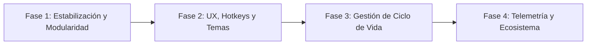

# 📋 Bitácora de Desarrollo y Hoja de Ruta (Roadmap)
## Proyecto: Lanzador Flotante de Acceso Rápido (Suite de IA Local)

Esta bitácora establece el estado actual del proyecto, el diagnóstico de arquitectura, las deudas técnicas detectadas, el plan de trabajo estructurado por fases y el registro histórico de cambios.

---

## 🧭 1. Visión y Diagnóstico Actual (v1.0.0)

El proyecto funciona como un **orquestador visual e IPC (Inter-Process Communication)** para una suite de 3 herramientas de Inteligencia Artificial que operan de forma local, offline y desatendida en Windows.

### Fortalezas Actuales
- **Diseño flotante ultra-ligero y minimalista:** Se oculta en el margen de pantalla (34 px de ancho) y no interrumpe el flujo de trabajo.
- **IPC basado en sockets locales de Qt (`QLocalSocket`):** No requiere puertos TCP de red abiertos ni configuraciones de firewall.
- **Control estricto de Instancia Única:** Evita instancias duplicadas del lanzador y de cada aplicación de la suite.
- **Arranque 100% silencioso:** Uso de scripts VBScript (`iniciar.vbs`) para evitar consolas CMD parpadeantes en Windows.
- **Persistencia de configuración:** Almacena lado de pantalla (`dock_side`) y posición vertical (`pos_y`) en `config.json`.

---

## 🔍 2. Deudas Técnicas y Oportunidades de Mejora

| ID | Área | Descripción de la Oportunidad / Deuda | Prioridad |
|---|---|---|---|
| **DT-01** | **Configuración** | Lista de aplicaciones (`APPS_CONFIG`) acoplada estáticamente en el código fuente de `launcher_window.py`. Debería poder leerse y extenderse desde `config.json` o un `apps.json`. | **Alta** |
| **DT-02** | **Ciclo de Vida** | El lanzador puede iniciar aplicaciones y traerlas al frente, pero no ofrece la opción de detenerlas/cerrarlas directamente desde la UI o el menú contextual. | **Media** |
| **DT-03** | **Atajos Globales** | Carece de combinación de teclas global (Global Hotkey como `Win+Alt+Space` o `Ctrl+Shift+A`) para invocar el panel sin usar el ratón. | **Media** |
| **DT-04** | **Resiliencia Venv** | Las rutas al entorno virtual están prefijadas a `C:\Users\%USERNAME%\.audio_translator_venv`. Debe formalizarse una detección más flexible y portable. | **Media** |
| **DT-05** | **Monitor de Recursos** | No se visualiza el consumo de memoria RAM o VRAM de las apps de IA activas en tiempo real. | **Baja** |
| **DT-06** | **Animaciones Suaves** | Las transiciones de expansión/plegado son instantáneas mediante `hide()` y `show()`; incorporar `QPropertyAnimation` mejoraría la fluidez visual. | **Baja** |

---

## 🗺️ 3. Plan de Trabajo y Fases de Evolución

### 🔹 Fase 1: Estabilización, Versionado y Modularidad (En Progreso)
- [x] Inicialización del repositorio Git (`git init`) con `.gitignore` adecuado en Lanzador y Asistente de Reunión.
- [x] Documentación exhaustiva técnica y de usuario en la carpeta `doc/`.
- [x] Formalización de dependencias en `requirements.txt`.
- [x] **Hito Asistente de Reunión (`10_Asistente-de-reunion`):**
  - Auditoría completa de rendimiento y latencia.
  - Modo cápsula **HUD Zen** ultra-compacto (52 px) con onda reactiva de 5 barras según volumen de voz.
  - Ocultación del scroll continuo de texto para eliminar distracción visual y carga gráfica.
  - Grabación de audio raw en streaming a `.wav` (16 kHz mono) con consumo cero de RAM.
  - Sincronización milimétrica audio-texto con formato dual estructurado: Markdown (`.md`) con Frontmatter YAML y Timeline JSON (`.json`) para reproductor interactivo futuro.
- [ ] Extraer la lista de aplicaciones hacia un archivo de configuración desacoplado (`apps.json`), permitiendo añadir nuevas utilidades sin tocar código Python.
- [ ] Verificación de existencia de las carpetas de las aplicaciones hermanas con fallbacks visuales elegantes si alguna app no está instalada.

### 🔹 Fase 2: Experiencia de Usuario y Atajos Globales
- [ ] Soporte para Atajo de Teclado Global en Windows (ej. `Alt + Shift + Z` o configurable) para abrir/plegar el panel flotante.
- [ ] Animación fluida de deslizamiento (*slide-in / slide-out*) mediante `QPropertyAnimation` al abrir y cerrar la solapa.
- [ ] Selector visual de temas en la interfaz (Dark Carbon, Slate Minimal, OLED Black).
- [ ] Opción de opacidad regulable para el panel desplegado.

### 🔹 Fase 3: Gestión Integral del Ciclo de Vida y Ecosistema de Grabaciones
- [ ] Menú contextual con clic derecho sobre cada tarjeta de aplicación:
  - Traer al frente / Enfocar.
  - Reiniciar aplicación.
  - Detener / Cerrar aplicación de forma limpia (vía señal por socket o terminación controlada).
  - Abrir carpeta contenedora en el explorador de Windows.
- [ ] Extensión del protocolo tri-format (`.wav` + `.md` + `.json`) a `09_TraductorAudio` y `08_TraductorLocal`.
- [ ] Prototipo del Frontend / Visor Intérprete Unificado (Web o Desktop) para explorar sesiones pasadas, reproducir audio con click-to-seek sobre el texto y exportar minutas.
- [ ] Opción en el footer: "Cerrar todas las aplicaciones de IA activas".

### 🔹 Fase 4: Telemetría Local y Métricas
- [ ] Detección sutil de uso de memoria (RAM / GPU) de las apps activas mediante `psutil` (opcional).
- [ ] Notificaciones toast no intrusivas cuando una aplicación de IA finalice una tarea pesada (ej. minuta de reunión lista).

---

## 📝 4. Registro Histórico de Cambios (Changelog)

Formato basado en [Keep a Changelog](https://keepachangelog.com/es-ES/1.0.0/) y versionado semántico.

### [1.1.0] - 2026-11-19
#### Añadido / Mejorado
- **Visualizador Flotante Ultra-Compacto:** Rediseño del disparador flotante a un tamaño minimalista de **20x20 px** con el icono `⚡` ajustado (eliminado el texto vertical y el bloque grande de 100px).
- **Semi-opacidad Dinámica:** En reposo se muestra semi-opaco (opacidad al 72%), subiendo automáticamente al 100% al pasar el cursor o durante el arrastre para no estorbar el contenido de pantalla.
- **Movimiento Libre con Ratón:** Arrastre continuo y fluido en tiempo real en coordenadas X e Y con el ratón por toda la pantalla.
- **Auto-Snap a Bordes de Pantalla:** Al soltar el icono con el ratón, se acopla magnéticamente al borde más cercano (izquierdo o derecho) a la altura exacta deseada y persiste la posición en `config.json`.
- **Alineación Inteligente del Panel:** Al expandirse, el panel se despliega centrado verticalmente respecto a la posición del icono flotante.
- **Atajo Escape:** Posibilidad de colapsar rápidamente el panel presionando la tecla `Esc`.

### [1.0.0] - 2026-11-19
#### Añadido
- Repositorio Git inicial para versionado y trazabilidad del proyecto.
- Archivo `.gitignore` para entornos Python, archivos temporales y logs.
- Archivo `requirements.txt` con especificación de versión para PyQt6.
- Carpeta `doc/` con suite completa de documentación técnica y operativa:
  - `01_proposito_y_vision.md`
  - `02_gestion_de_apps_e_ipc.md`
  - `03_guia_de_uso.md`
  - `04_dependencias_y_entorno.md`
  - `05_utilidades_y_herramientas.md`
- Bitácora de desarrollo `BITACORA.md` con diagnóstico, deudas técnicas y hoja de ruta.
- Funcionalidad base del lanzador flotante con solapa retraíble, arrastre vertical, detección de estado mediante `QLocalSocket` y lanzadores silenciosos VBScript.
