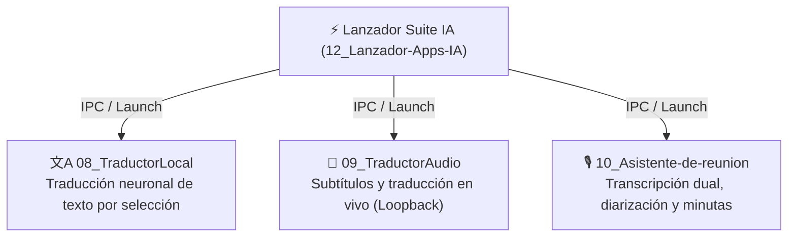

# 🎯 01. Propósito y Visión General

## 1. El Problema que Resuelve
En un entorno de trabajo con herramientas de Inteligencia Artificial locales (modelos de traducción neuronal, transcripción de voz whisper, diarización y resúmenes ejecutivos), los usuarios suelen enfrentarse a dos escenarios incómodos:
1. **Llenar la barra de tareas de Windows** con múltiples aplicaciones abiertas o consolas de comandos negras (`cmd.exe`).
2. **Tener que navegar manualmente** por carpetas del explorador de archivos para buscar y ejecutar cada script `main.py` o `.bat` cada vez que necesitan traducir un texto, activar subtítulos o registrar una reunión.

## 2. El Propósito del Lanzador
El **Lanzador Flotante de Acceso Rápido** (`12_Lanzador-Apps-IA`) nace para ser el **punto de entrada unificado y discreto** para todo el ecosistema de IA local.

```
+-------------------------------------------------------------+
|                     Pantalla de Windows                     |
|                                                             |
|   [ Ventana de Trabajo: Chrome / Word / Teams / PDF ]       |
|                                                          [⚡] <-- Solapa retraída
|                                                          [IA]     (26-34 px)
+-------------------------------------------------------------+
```

Al hacer clic en la solapa, se expande instantáneamente un panel flotante que permite:
- Conocer de un vistazo qué aplicaciones ya están corriendo en segundo plano (indicador verde `●` o gris `○`).
- Iniciar con un solo clic cualquier aplicación que no esté corriendo.
- Si una aplicación ya está en ejecución, enfocarla y traerla al frente de inmediato sin duplicar procesos.
- Plegarse automáticamente tras la interacción o por inactividad para no entorpecer el trabajo.

---

## 3. Principios de Diseño
- **100% Offline y Privado:** No realiza consultas a internet ni servicios de telemetría externos.
- **Ultra Ligero:** Construido sobre PyQt6 con bajo consumo de memoria RAM (< 45 MB en reposo).
- **Cero Ventanas Negras:** Ejecución 100% silenciosa mediante VBScript, eliminando las molestas ventanas de consola de Windows.
- **No Invasivo:** Permanece colapsado en un extremo de la pantalla sin solapar botones críticos del sistema operativo.
- **Ergonómico:** Permite desplazar la solapa verticalmente por el borde de la pantalla o alternar entre el lateral izquierdo o derecho con un solo clic.

---

## 4. Ecosistema de la Suite Integrada

El lanzador interactúa directamente con tres herramientas hermanas ubicadas en el mismo directorio raíz (`G:\Mi unidad\08_Programas PC\`):



1. **`08_TraductorLocal` (Traductor de Texto Instantáneo):**
   - Captura selecciones de texto en cualquier aplicación de Windows mediante monitoreo global del ratón.
   - Traduce al instante bidireccionalmente (Inglés ↔ Español) usando modelos neuronales locales.
2. **`09_TraductorAudio` (Traductor de Audio en Tiempo Real):**
   - Captura el audio del sistema operativo (WASAPI Loopback) para conferencias (Teams, Zoom, Meet) o videos (YouTube).
   - Muestra subtítulos flotantes estilizados con traducción de inglés a español en tiempo real.
3. **`10_Asistente-de-reunion` (Asistente de Reuniones y Minutas):**
   - Graba de forma dual (Micrófono + Audio de PC), diariza interlocutores y genera minutas ejecutivas con compromisos adquiridos (*action items*).
