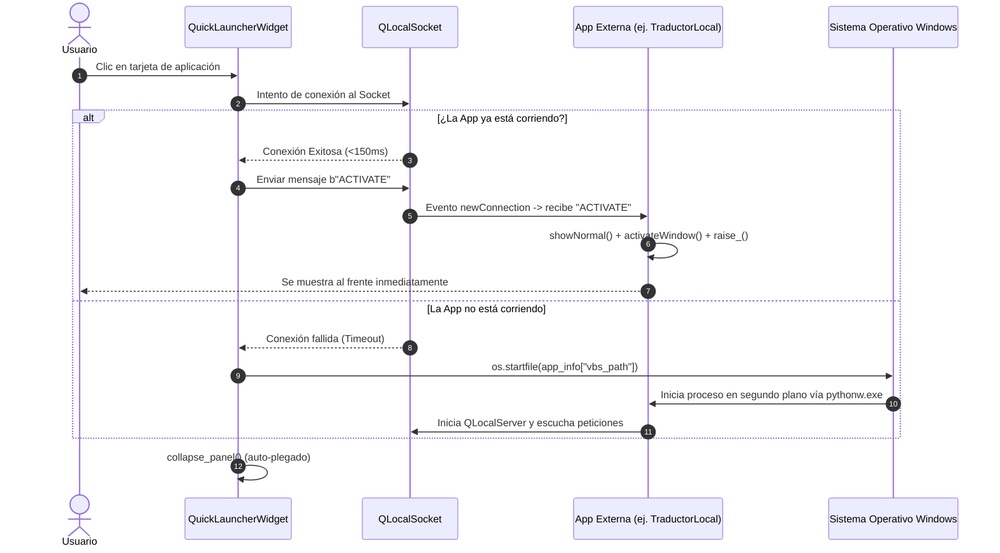

# 📡 02. Gestión de Aplicaciones y Comunicación IPC

Este documento detalla la arquitectura de comunicación entre procesos (IPC), el control de instancia única y los mecanismos de activación y ejecución que utiliza el **Lanzador de Apps IA** para controlar las demás aplicaciones de la suite.

---

## 1. Topología de Carpetas y Detección de Rutas

El lanzador reside en la carpeta `12_Lanzador-Apps-IA` dentro del directorio padre común de herramientas:

```
G:\Mi unidad\08_Programas PC\
├── 08_TraductorLocal\
│   ├── iniciar.vbs
│   └── main.py (Socket: "TraductorLocal_SingleInstance_2026")
├── 09_TraductorAudio\
│   ├── iniciar.vbs
│   └── main.py (Socket: "TraductorAudio_SingleInstance_2026")
├── 10_Asistente-de-reunion\
│   ├── iniciar.vbs
│   └── main.py (Socket: "AsistenteReunion_SingleInstance_2026")
└── 12_Lanzador-Apps-IA\
    ├── config.json
    ├── launcher_window.py (Configuración de apps y sockets)
    └── main.py (Socket: "LanzadorSuiteIA_SingleInstance_2026")
```

En `launcher_window.py`, la variable `PARENT_DIR` calcula dinámicamente la ruta base:
```python
APP_DIR = os.path.dirname(os.path.abspath(__file__))
PARENT_DIR = os.path.dirname(APP_DIR)
```
Esto garantiza que si la carpeta completa de la suite es movida a otra unidad de disco (por ejemplo de `G:` a `D:`), los enlaces entre aplicaciones continúan funcionando sin necesidad de reconfigurar rutas absolutas.

---

## 2. Protocolo IPC: Sockets Locales de Qt (`QLocalSocket` / `QLocalServer`)

En lugar de depender de llamadas a la API de Windows (`FindWindow`, `SetForegroundWindow`, `EnumWindows`) o de abrir puertos de red TCP (que disparan alertas de firewall), el ecosistema utiliza **Named Pipes / Sockets de Dominio Local de Qt**:

- En Windows, `QLocalServer` crea un Named Pipe con el identificador asignado (ejemplo: `\\.\pipe\TraductorLocal_SingleInstance_2026`).
- Es un canal seguro, restringido a la sesión de usuario local, de ultra-baja latencia y sin sobrecarga de red.

### Tabla de Sockets del Ecosistema

| Aplicación | ID Interno | Nombre de Socket IPC | Script de Inicio |
|---|---|---|---|
| **Lanzador** | `lanzador` | `LanzadorSuiteIA_SingleInstance_2026` | `12_Lanzador-Apps-IA\iniciar.vbs` |
| **Traductor Texto** | `traductor_local` | `TraductorLocal_SingleInstance_2026` | `08_TraductorLocal\iniciar.vbs` |
| **Traductor Audio** | `traductor_audio` | `TraductorAudio_SingleInstance_2026` | `09_TraductorAudio\iniciar.vbs` |
| **Asistente Reunión** | `asistente_reunion` | `AsistenteReunion_SingleInstance_2026` | `10_Asistente-de-reunion\iniciar.vbs` |

---

## 3. Detección de Estado en Vivo (Health Check)

El lanzador implementa un temporizador `status_timer = QTimer()` que se ejecuta **cada 2000 ms (2 segundos)**:

```python
def check_socket_status(socket_name: str) -> bool:
    sock = QLocalSocket()
    sock.connectToServer(socket_name)
    connected = sock.waitForConnected(70)  # Espera máx 70ms
    if connected:
        sock.disconnectFromServer()
    return connected
```

### Funcionamiento:
1. `sock.connectToServer(socket_name)` intenta conectarse al Named Pipe de la aplicación.
2. Si el servidor responde en menos de 70 milisegundos:
   - Se confirma que la aplicación **está en ejecución**.
   - El punto de estado de la tarjeta se pinta de verde: `●` (`#10b981`).
   - El tooltip indica: `Estado: En ejecución (Clic para enfocar)`.
3. Si la conexión expira o el socket no existe:
   - Se confirma que la aplicación **está inactiva**.
   - El punto se pinta de gris: `○` (`#52525b`).
   - El tooltip indica: `Estado: Inactivo (Clic para iniciar)`.

> [!NOTE]
> El tiempo de espera de 70 ms no bloquea la interfaz de usuario de manera apreciable y descarta de inmediato aplicaciones que no estén abiertas.

---

## 4. Mecanismo de Activación (`Single Instance Focus`)

Cuando el usuario hace clic sobre una aplicación en el panel, se ejecuta la función `launch_or_activate(app_info)`:



### El Mensaje `ACTIVATE`
En el lado de la aplicación que recibe la señal:
```python
if "ACTIVATE" in data:
    on_activate_cb()  # Restaura ventana, quita minimizado y da foco
```
Esto garantiza que nunca se creen múltiples instancias de traductores o asistentes peleándose por los micrófonos o por los ganchos de ratón (*mouse hooks*).

---

## 5. Lanzamiento Silencioso mediante VBScript (`iniciar.vbs`)

Si la aplicación no está en ejecución, el lanzador invoca su archivo `iniciar.vbs`:
```python
vbs_path = app_info.get("vbs_path", "")
if os.path.exists(vbs_path):
    os.startfile(vbs_path)
```

### ¿Por qué `iniciar.vbs` y no un `.bat`?
- Un archivo `.bat` ejecutado mediante `subprocess` o `os.system` causa un **parpadeo negro en pantalla** (`cmd.exe`) durante unos milisegundos.
- El script VBScript utiliza `WScript.Shell.Run strCommand, 0, False`:
  - El parámetro `0` corresponde a `vbHide` (ventana 100% oculta e invisible).
  - El parámetro `False` permite que el lanzador no se quede esperando a que el proceso termine; es asíncrono y no bloqueante.
- Además, el VBScript resuelve el ejecutable `pythonw.exe` buscando primero el entorno optimizado en `C:\Users\%USERNAME%\.audio_translator_venv\` y como respaldo el `.venv` local.

---

## 6. Control de Instancia Única del Propio Lanzador

El propio lanzador se protege a sí mismo de ejecuciones duplicadas en `main.py`:
- Al arrancar, intenta conectar a `LanzadorSuiteIA_SingleInstance_2026`.
- Si se conecta, envía `b"ACTIVATE"` a la instancia existente (lo cual hace que el panel se despliegue de inmediato frente al usuario) y la nueva instancia termina con `sys.exit(0)`.
- Si no existe una instancia previa, crea el `QLocalServer` y queda en modo escucha.
