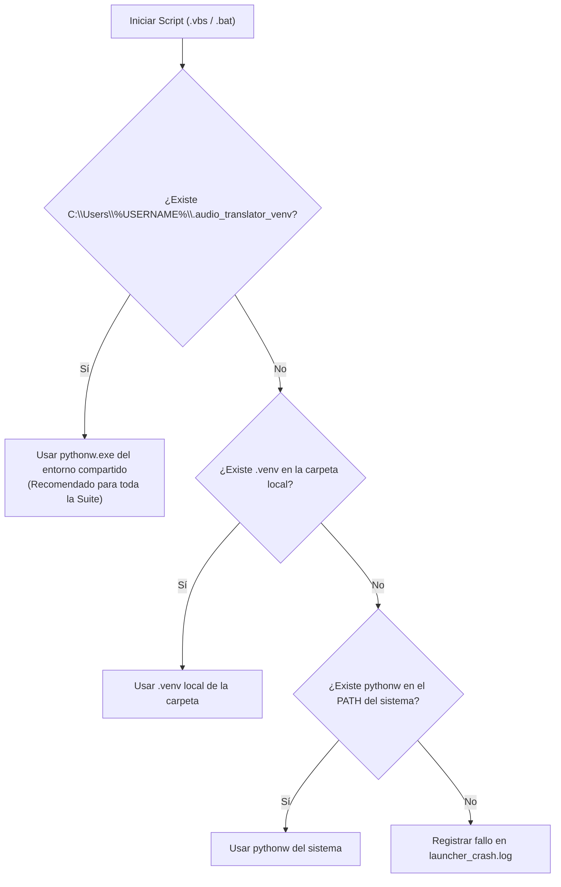

# 📦 04. Dependencias y Entorno de Ejecución

Este documento especifica los requisitos de software, dependencias y la estrategia de resolución de entornos virtuales que utiliza el proyecto.

---

## 1. Requisitos de Software

- **Sistema Operativo:** Windows 10 (Build 19041 o superior) / Windows 11 (64-bit).
- **Intérprete de Python:** Python 3.10, 3.11 o 3.12 (64-bit).
- **Privilegios:** Usuario estándar (no requiere permisos de Administrador).

---

## 2. Dependencias Principales (`requirements.txt`)

El lanzador tiene una arquitectura ligera y no requiere librerías pesadas de cálculo científico ni librerías de IA directamente (los modelos corren en sus respectivas aplicaciones independientes):

| Paquete | Versión Recomendada | Módulos Utilizados | Propósito |
|---|---|---|---|
| **`PyQt6`** | `>=6.5.0, <6.9.0` | `QtWidgets`, `QtCore`, `QtGui`, `QtNetwork` | Interfaz gráfica, widgets sin bordes, temporizadores, sombras, bandeja del sistema y sockets IPC. |

### Instalación de dependencias:
```bash
pip install -r requirements.txt
```

---

## 3. Jerarquía de Resolución del Intérprete Python

Tanto los scripts de inicio `.vbs` como los `.bat` implementan un orden de búsqueda inteligente para encontrar el entorno virtual óptimo:



### ¿Por qué existe un entorno compartido en `C:\Users\%USERNAME%\.audio_translator_venv`?
En discos con sincronización en la nube (como Google Drive `G:\Mi unidad\`), compilar o ejecutar miles de archivos `.pyc` dentro de un `.venv` local puede provocar retrasos de sincronización y bloqueos de archivos por parte de Windows. Alojar el entorno virtual en una ruta local de `C:\` agiliza notablemente los tiempos de carga y respuesta de toda la suite.

---

## 4. Configuración de un Nuevo Entorno (Paso a Paso)

Si clonas este repositorio en una máquina nueva:

1. **Crear el entorno virtual:**
   ```powershell
   python -m venv .venv
   ```

2. **Activar el entorno virtual:**
   ```powershell
   .\.venv\Scripts\Activate.ps1
   ```

3. **Actualizar gestor de paquetes e instalar dependencias:**
   ```powershell
   python -m pip install --upgrade pip
   pip install -r requirements.txt
   ```

4. **Probar la ejecución en modo consola:**
   ```powershell
   python main.py
   ```

---

## 5. Consideraciones de Pantalla y Escalado DPI (Windows)

- PyQt6 habilita de forma predeterminada el soporte para pantallas **High-DPI** mediante escalado automático por monitor (`Per-Monitor DPI Aware v2`).
- El lanzador consulta la geometría disponible mediante `QApplication.primaryScreen().availableGeometry()`:
  - Esto descuenta automáticamente la barra de tareas de Windows para evitar que la solapa o el panel queden tapados.
  - El límite superior e inferior de arrastre vertical se ajusta dinámicamente según la resolución detectada del monitor principal.
